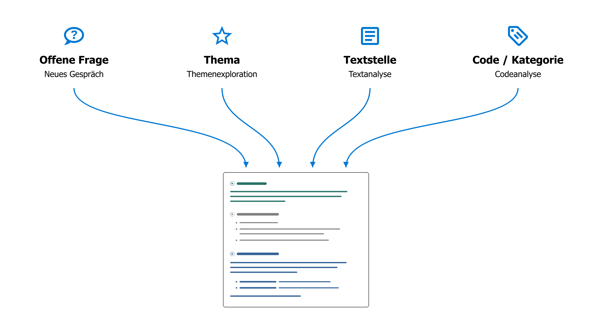

# Mit dem KI-Agenten Daten analysieren

## Grundprinzipien der KI-Integration {#core-principles-of-ai-integration}

**1) KI-Vielfalt**

Der KI-Agent in QualCoder ist nicht an ein bestimmtes Modell gebunden. Sie entscheiden, welches KI-Sprachmodell Sie verwenden - sei es eines der großen kommerziellen Modelle, ein mittelgroßes Modell auf einer wissenschaftlichen KI-Plattform, oder ein lokales Sprachmodell auf Ihrem eigenen Computer. Mehr Informationen unter [KI einrichten](./2.3.-AI-Setup.md).

**2) Methodenvielfalt**

Der KI-Agent in QualCoder definiert keine eigene Methode, sondern bietet eine methodisch flexible Experimentierplattform. Ihre Forschungsfrage, Ihr Erkenntnisinteresse und Ihr methodisches Vorgehen geben die Richtung vor. Hat sich ein Vorgehen bewährt, lässt es sich speichern und später wiederverwenden (siehe [KI-Prompt-Bibliothek](./6.3.-AI-Prompt-Library.md)).

**3) Transparenz**

Die Prompts, die die Arbeit des KI-Agenten steuern, sind einsehbar und können grundsätzlich angepasst werden. Aber auch während der Arbeit informiert der Agent fortlaufend über seine Schritte und gibt detaillierte Quellenverweise. So können Sie nachvollziehen, auf welche Daten er sich stützt, und die Passagen im ursprünglichen Kontext prüfen.

**4) Kollaboration statt Automatisierung**

Im Mittelpunkt steht ein dialogischer Umgang mit KI: zusätzliche Perspektiven entwickeln, eigene Deutungen hinterfragen und das Material besser verstehen. Auf Wunsch arbeitet der Agent auch längere Arbeitsaufträge semi-autonom ab. Großflächige Automatisierung war aber nie das primäre Ziel.

## Arbeit mit dem KI-Agenten {#working-with-the-ai-agent}

- Der KI-Agent hat seinen **eigenen Tab** in QualCoder. Sie können ihn mit einem Klick auf den kleinen Pfeil-Button aber auch in eine **Seitenleiste** (s.u.) schieben, neben den Daten.
{ width="118" }
- Im Chatfenster beschreiben Sie in eigenen Worten, was Sie untersuchen oder bearbeiten möchten.

{ width="600" }

!!! note
    Die KI muss **vollständig geladen** und bereit für neue Abfragen sein, bevor ein Chat gestartet werden kann (Statusleiste: „KI: bereit“).

### Wozu dient der KI-Agent? {#what-is-the-ai-agent-for}

- Der KI-Agent unterstützt Sie dabei, Ihr **empirisches Material zu erkunden,** Interpretationen und Analysen zu entwickeln, zu Codieren und Memos zu schreiben.
- Sie können mit der KI über einzelne Textstellen diskutieren oder auch im gesamten Materialkorpus des Projekts nach Themen oder Kontrastfällen suchen.
- Sie können Ihr Codesystem weiterentwickeln, Ideen und Analysestrategien brainstormen und direkt am empirischen Material überprüfen.
- Im Unterschied zu generischen Chatbots macht der KI-Agent in QualCoder dabei **genau dort weiter, wo die bisherige Analyse aufgehört hat:** Er inspiziert das aktuelle Codesystem, kann Memos und Codierungen lesen, Fälle und deren Merkmale (Attribute) in die Analyse einbeziehen, etc. So erhalten Sie Feedback, das genau zum aktuellen Stand der Untersuchung passt.

### Welche Möglichkeiten hat der KI-Agent? {#what-can-the-ai-agent-do}

- Schon mit reinem **Lesezugriff** auf das Projekt ist der KI-Agent ein mächtiges Brainstorming-Tool.
- Auf Wunsch kann er aber nicht nur Fragen beantworten, sondern die **Analyse auch aktiv vorantreiben.** Mit den entsprechenden Berechtigungen (s.u.) kann er neue Codes anlegen oder bestehende reorganisieren, neue Textpassagen suchen und codieren, Memos überarbeiten oder neue Fallattribute erstellen.
- Im Gespräch mit dem Agenten können Sie Vorschläge prüfen, Rückfragen stellen und das weitere Vorgehen bestimmen.

### Welche Grenzen gibt es? {#what-are-its-limitations}

- Aktuell kann der KI-Agent nur mit **Textdaten** arbeiten, nicht mit Bildern, Audio oder Video – und auch nicht mit Notizbüchern.
- Sie können zwischen drei Berechtigungsstufen wählen:

|Berechtigungsstufe|Beschreibung|
|---|---|
|**Schreibgeschützt**|Der KI-Agent hat nur Lesezugriff auf Codes, Memos und empirische Daten.|
|**Sandbox** (Standard)|Limitierter Schreibzugriff – der Agent kann eigene Codes und Codierungen anlegen, aber keine bestehenden verändern.|
|**Vollzugriff**|Der Agent kann fast alles tun, was auch ein:e menschliche:r Nutzer:in kann, einschließlich Änderungen im Codesystem, bei Fällen, Memos und Attributen.|

- Eine **strikte Grenze** gibt es jedoch immer: Die empirischen Daten selbst bilden die "ground truth" der gesamten Analyse. Sie können unter keinen Umständen durch KI verändert werden.
- Außerdem hat der KI-Agent **keinen Zugriff auf externe Informationen,** etwa aus dem Internet. Er kann also nur mit den Daten arbeiten, die Sie bewusst in das Projekt aufgenommen haben.

### Wie sehe ich, welche Änderungen die KI vornimmt? {#how-can-i-see-which-changes-the-ai-makes}

- Der Agent **dokumentiert seine Arbeitsschritte im Chat,** macht Quellenangaben, und fragt bei größeren Eingriffen vorher nach.
- Die letzten Änderungen des KI-Agenten lassen sich mit dem entsprechenden Button im Chatfenster leicht **rückgängig** machen:

    { width="250" }

- Alle neuen Elemente, die der Agent anlegt (Codes, Codierungen, etc.), werden mit dem **speziellen Coder-Namen "AI Agent" gekennzeichnet.**

    { width="600" }

- Wenn Sie KI-generierte Codes **ein- oder ausblenden** wollen, klicken Sie im Codierdialog auf die drei Punkte ("...") oben links neben dem Namen des aktuellen Coders und stellen die Sichtbarkeit für "AI Agent" ein.

    { width="250" }

### Wie bereite ich mein Projekt vor? {#how-should-i-prepare-my-project}

- Wichtig ist ein aussagekräftiges **Projektmemo** (Menü "Projekt > Projektmemo"). Halten Sie dort fest:

    - Forschungsfrage und Ziele des Projektes
    - Die Art des empirischen Materials (z.B. narrative Interviews) und das Sampling
    - Den methodischen Ansatz für die Auswertung
    - Weitere Besonderheiten, die der KI-Agent berücksichtigen soll.

    Das Projektmemo wird dem Agenten als Hintergrundinformation für jedes Gespräch mitgegeben.

- **Dokumentnamen** sollten verständlich sein (z.B. "Interview Alice")
- In **Interviewtranskripten** sollten Interviewer:in und Befragte klar gekennzeichnet sein, damit auch in kürzeren Textauszügen die Rollen klar erkennbar sind.
- Gute **Codememos** helfen auch der KI nachzuvollziehen, was Sie meinen.

!!! note
    **Projektstruktur auf KI-Eignung prüfen**: Mit diesem Befehl im Menü "KI" analysiert der Agent das Projekt automatisch und macht Vorschläge für eine bessere Lesbarkeit.

!!! note
    **Persönliche Notizen in Memos:** Wenn Sie Memos auch für persönliche Notizen nutzen wollen, schreiben Sie diese hinter die Zeichenfolge `#####` als Trenner. Alles danach ist für die KI nicht lesbar.

### Wie arbeitet der KI-Agent? {#how-does-the-ai-agent-work}

- Der KI-Agent wird nur tätig, wenn Sie ihm einen **Auftrag** geben, nicht von sich aus.
- Der Agent bearbeitet einen Auftrag in einer sogenannten **ReAct loop** (Reflect + Act, [Shunyu et al. 2022](https://arxiv.org/abs/2210.03629)):

    1. Ein Plan wird erstellt, wie die Aufgabe umgesetzt werden soll.
    2. Die geplanten Aktionen werden durchgeführt (z.B. Daten suchen, Codes lesen).
    3. Der Agent analysiert die Ergebnisse und entscheidet, ob weitere Aktionen nötig sind (z.B. mehr Daten lesen) - dann Rückkehr zu Schritt 2.

    Je nach Komplexität der Aufgabe kann diese Schlaufe viele Male durchlaufen werden. Die einzelnen Schritte werden im Chatfenster in grau angezeigt.
    Wenn das Ergebnis zufriedenstellend ist (z.B. genug Daten gefunden), formuliert der Agent eine fertige Antwort und wartet auf weitere Instruktionen.

- Der Agent hat **mächtige Werkzeuge** zur Verfügung: Er kann bspw. eine semantische Ähnlichkeitssuche im gesamten Materialkorpus durchführen, mit regulären Ausdrücken oder in einem BM25-Stichwortindex suchen, sowie Tools aufrufen, um Codes zu erstellen oder zu ändern, wenn er Schreibrechte hat.

### Was passiert mit meinen Daten? {#what-happens-to-my-data}

- Alle Daten bleiben grundsätzlich **lokal auf Ihrem Rechner** im aktuellen QualCoder-Projekt. Auch die genannten Suchoperationen laufen hier.
- Das **KI-Modell sieht immer nur den Ausschnitt der Daten** (bspw. Suchergebnisse oder einzelnen Textpassagen), der für die aktuelle Analyse konkret gebraucht wird. Diese Datenfragmente werden zusammen mit dem jeweiligen Auftrag an das KI-Modell gesandt.
- In seinen Antworten dokumentiert der KI-Agent ausführlich die Datenbasis seiner Analysen. QualCoder übersetzt das in **Quellenlinks mit Zeilennummern.** Ein Klick auf diese Quellenangabe öffnet die Passage im ursprünglichen Kontext.

## Vier Wege in die Konversation mit dem Agenten {#four-ways-to-start-a-conversation-with-the-agent}

Unten links im Fenster des KI-Agenten können Sie eine neue Analyse in einer der vier Varianten starten:

{ width="250" }

Diese Varianten bilden lediglich **unterschiedliche Ausgangspunkte** für die Analyse. Anschließend können Sie das Gespräch in jede beliebige Richtung weiterentwickeln.

### 1) Neuer, offener Chat {#1-new-open-chat}

Das ist der flexibelste Weg, eine neue Analyse mit dem Agenten zu initiieren. Beginnen Sie mit einer Idee, einer offenen Frage, oder benennen Sie die Codes oder Textstellen, die Sie untersuchen wollen.

**Beispiel: Vergleichsfälle suchen**

> *"Ab Zeile 127 erzählt Sarah von ihrer Kindheit in England und dass sich dort vor allem ihr Vater um sie gekümmert hat. Gibt es ähnliche Fälle im Material, wo Männer eine so zentrale Rolle in der Sorgearbeit einnehmen?"*

**Beispiel: Codes konsolidieren**

> *"Ich habe den Eindruck, dass sich die Codes ‚Eigenverantwortung‘ und ‚Selbstständigkeit‘ häufig überschneiden. Schau dir die Memos und codierten Passagen an. Wie könnten wir die Codes klarer abgrenzen? Oder sollen wir sie besser zusammenfassen?"*
>
>
> dann: *"Gut, führe beide Codes unter dem neuen Namen 'Selbstverantwortung' zusammen und passe auch das Codememo entsprechend an."*

**Beispiel: Informationen extrahieren**

> *Untersuche alle Interviews daraufhin, welche Position jede befragte Person zu Beschränkungen der Social-Media-Nutzung von Kindern und/oder Jugendlichen äußert. Ordne jede befragte Person genau einer Kategorie zu:  
> **pro** = ausdrücklich für eine Beschränkung;  
> **contra** = ausdrücklich gegen eine Beschränkung;  
> **undecided** = relevante, aber ambivalente, widersprüchliche oder nicht eindeutig zuordenbare Aussagen;  
> **unknown** = keine hinreichende einschlägige Aussage.  
> Berücksichtige nur Positionen, die der befragten Person klar zugerechnet werden können, und prüfe den Kontext der Fundstellen. Zeige mir zunächst für jede Person die vorgeschlagene Kategorie, eine kurze Begründung und die maßgeblichen Textstellen mit Quellenangabe. Weise Widersprüche und unsichere Zuordnungen ausdrücklich aus.  
> Lege erst nach meiner Bestätigung das Attribut "social_media_restriction" für die Interviewtranskripte an mit den zulässigen Werten "pro", "contra", "undecided" und "unknown" und speichere die Zuordnungen.*

Wenn Sie **vorgefertigte oder eigene Prompts** aus der [KI-Prompt-Bibliothek](./6.3.-AI-Prompt-Library.md) in das Gespräch integrieren wollen, nutzen Sie die sogenannte 'Slash-Notation': "/in-vivo-coding" würde bspw. einen entsprechenden Prompt, den Sie zuvor in der Prompt-Bibliothek gespeichert haben, in das aktuelle Gespräch übernehmen.

### 2) Themenexploration {#2-topic-exploration}

Diese Analyse eignet sich vor allem, um eine **erste Übersicht** zu bekommen, wie ein bestimmtes Thema im empirischen Material verhandelt wird. Bei einfachen Fragestellungen mit klar eingrenzbaren Themen können Sie mit dieser Funktion auch zusammenfassende Analysen erstellen, die direkt in einem Bericht weiterverarbeitet werden können.

- Die Option öffnet einen **Dialog,** in dem Sie das Thema festlegen und beschreiben sowie die Daten auswählen können, die in die Analyse einbezogen werden.
- Hier können Sie auch zwischen verschiedenen **Analyseprompts** auswählen, bspw. einer einfachen Zusammenfassung (topic-summary) oder einer fallvergleichenden Analyse (analyze-differences). Vorlagen für eigene Analysen mit detaillierten Instruktionen können Sie in der [KI-Prompt-Bibliothek](./6.3.-AI-Prompt-Library.md) erstellen und dann hier verwenden.
- Die Themenexploration startet zunächst eine mehrschrittige Suche im Material und legt dann einen ersten Bericht vor.

**Beispiel: explorativer Fallvergleich**

> **Thema:** "Kinder aufziehen im Krieg"  
> **Beschreibung:** "Wie beeinflusst der Krieg die Entscheidung, Kinder zu bekommen? Wie ändert sich Sorgearbeit im Krieg? Wie versuchen Eltern, unter Kriegsbedingungen Kindheit zu ermöglichen?"  
> **Analyseprompt:** "analyze-differences"  
> **Filter:** Nur Fälle "Ethel" und "Flora" ausgewählt.  
>
> **Ergebnis:** Eine fallvergleichende Analyse von Ethel und Flora zum Thema "Kinder aufziehen im Krieg", strukturiert entlang der drei Unterfragen.

### 3) Textanalyse {#3-text-analysis}

- Ermöglicht die **textnahe Analyse einer ausgewählten Passage** mit dem KI-Agenten.
- Entwickeln Sie gemeinsam neue Lesarten und Codevorschläge, oder diskutieren Sie Ambivalenzen, Unklarheiten sowie offene Fragen der Interpretation.

Diese Analyse wechselt zunächst in den **Text-Codieren-Arbeitsbereich**.
Öffnen Sie dort ein Dokument, markieren Sie die zu analysierende Textpassage und wählen im Rechtsklick-Menü die Option „KI-Textanalyse“. Ein **Untermenü** öffnet sich, in dem zwischen verschiedenen Varianten der Textanalyse gewählt werden kann:

{ width="600" }

Lassen Sie die Maus kurz auf einem Eintrag ruhen, um einen Tooltip mit weiteren Informationen zu sehen.
Sie können auch eigene Instruktionen für die Textanalyse in der [KI-Prompt-Bibliothek](./6.3.-AI-Prompt-Library.md) hinterlegen. Sie werden dann ebenfalls in diesem Untermenü zur Auswahl angezeigt.

**Beispiel: Brainstorming in der frühen Phase des close reading**

> a) **Auswahl** einer besonders dichten Interviewpassage im "Text codieren"-Tab.  
> b) Rechtsklick, "KI-Textanalyse" > **"interactive-brainstorming-with-ai"**  
> c) Es erfolgt ein Wechsel in den "KI-Agent"-Tab. Dort fragt der Agent zunächst nach der **Analyseperspektive** bzw. dem Thema, das vertieft werden soll.  
> d) Dann beginnt ein **Gespräch über das Material,** in dem gemeinsam verschiedene Deutungsmöglichkeiten durchgespielt und diskutiert werden.  
> e) **Ergebnisse sichern:** Wenn Sie fertig sind, instruieren Sie den KI-Agenten, eine Zusammenfassung der Ergebnisse als Textannotierung zu speichern.

### 4) Codeanalyse {#4-code-analysis}

- Analysiert alle **Daten, die unter einem bestimmten Code oder einer Kategorie gesammelt wurden,** einschließlich der Untercodes.
- Diskutieren Sie Ihre Codierungen mit dem KI-Agenten, vergleichen Sie verschiedene Codes, erzeugen Sie Untercodes oder erstellen Sie Berichte.
- Sie können auch **mehrere Codes und/oder Kategorien** auswählen für eine vergleichende oder zusammenfassende Analyse.

Eine neue Codeanalyse öffnet wieder zunächst einen **Dialog,** in dem Sie den oder die zu analysierenden Code(s) bzw. Kategorie(n) auswählen, die einbezogenen Daten filtern und einen Analyseprompt auswählen können.
Auch für diese Funktion können Sie eigene Prompts in der [KI-Prompt-Bibliothek](./6.3.-AI-Prompt-Library.md) erstellen.

**Beispiel:**

> **Code:** "Nachbarschaftliche Solidarität"  
> **Analyseprompt:** "theoretical-saturation-check"  
> **Filter:** Kein Filter (= alle Daten werden einbezogen)  
>
> **Ergebnis:** Ein ausführlicher Bericht zur "theoretischen Sättigung" des aktuellen Codes bzw. der ausgewählten Kategorie im Sinne der Grounded Theory. Dabei sucht der KI-Agent aktiv im Material nach bisher nicht codierten Varianten des im Code erfassten Phänomens, nach Grenzfällen und Gegenbeispielen, um die empirische sowie konzeptionell-theoretische Sättigung des Codes zu prüfen und Lücken aufzudecken. Dabei wird auch das Memo des Codes einbezogen.

## Abschließend: Zur Frage der Anthropomorphisierung {#a-final-reflection-on-anthropomorphism}

Wir haben uns bewusst dagegen entschieden, dem KI-Agenten in QualCoder einen Namen zu geben, wie bspw. "Claude" von Anthropic. Trotzdem ist es so, dass der dialogische Ansatz der KI-Integration in QualCoder eine Art Pseudo-Interaktion inszeniert, die sich in vieler Hinsicht an menschlichen Interaktionsmustern bspw. im Rahmen einer Forscher:innengruppe orientiert. In seinem [grundlegenden Systemprompt](https://github.com/ccbogel/QualCoder/blob/master/src/qualcoder/ai_prompts/_agent.md) wird dem KI-Agenten in QualCoder genau so eine Rolle als quasi Teammitglied zugewiesen. Anthropomorphisieren wir also eine Maschine, indem wir mit ihr interagieren, als sei sie eine menschliche Forscherin/ein Forscher?

Zu einem gewissen Grad ist das tatsächlich der Fall. Aber mir scheint es am sinnvollsten, diese Interaktionen als eine Art "Rollenspiel" zu betrachten, wie es [Shanahan, McDonell & Reynolds 2023](https://www.nature.com/articles/s41586-023-06647-8) vorgeschlagen haben. Heutige KI-Sprachmodelle sind an menschlich-sprachlichen Interaktionen trainiert. Sie funktionieren deshalb am besten, wenn man sie in solche Interaktionssituationen integriert. Trotzdem ist für einen methodisch reflektierten Umgang mit KI in der qualitativen Sozialforschung sehr wichtig, nicht zu vergessen, dass wir es hier mit einem technologisch induzierten Rollenspiel zu tun haben und nicht mit einem menschlichen Gegenüber interagieren.

## Weitere Funktionen {#further-functions}

- In der **[KI-Prompt-Bibliothek](./6.3.-AI-Prompt-Library.md)** können Sie erfolgreiche Analysestrategien und methodische Vorgehensweisen als wiederverwendbare Instruktionen für später speichern.
- **[KI-unterstütztes Codieren](./4.2.-AI-Assisted-Coding.md)** im Arbeitsbereich 'Text codieren'. Dort hilft eine KI-basierte Suche, passende Textstellen zu einem bestimmten Code im gesamten Materialkorpus zu finden.
- Wenn Sie **Fragen zur Bedienung von QualCoder** haben, kann der KI-Agent Sie auch dabei unterstützen und Antworten auf Basis der QualCoder-Dokumentation erstellen. Wählen Sie im Hauptmenü *Hilfe > Den KI-Agenten fragen* aus.