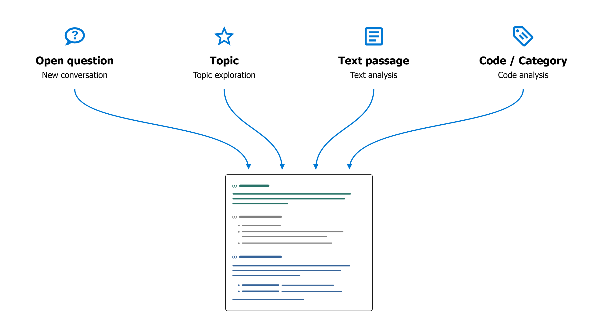

# Analysing data with the AI agent

## Core principles of AI integration {#core-principles-of-ai-integration}

**1) Choice of AI models**

The AI agent in QualCoder is not tied to a particular model. You decide which AI language model to use, whether it is one of the large commercial models, a medium-sized model on an academic AI platform, or a local language model on your own computer. For more information, see [AI Setup](./2.3.-AI-Setup.md).

**2) Methodological flexibility**

The AI agent in QualCoder does not define a method of its own. Instead, it provides a methodologically flexible platform for experimentation. Your research question, the insights you seek, and your methodological approach set the direction. Once an approach has proved useful, you can save it and reuse it later (see the [AI Prompt Library](./6.3.-AI-Prompt-Library.md)).

**3) Transparency**

The prompts that guide the AI agent's work are accessible and can, in principle, be adapted. While working, the agent also keeps you informed about its steps and provides detailed source references. This allows you to see which data it draws on and examine passages in their original context.

**4) Collaboration rather than automation**

The focus is on working with AI through dialogue: developing additional perspectives, questioning your own interpretations, and gaining a better understanding of the material. On request, the agent can also carry out longer tasks semi-autonomously. Large-scale automation, however, has never been the primary goal.

## Working with the AI agent {#working-with-the-ai-agent}

- The AI agent has its **own tab** in QualCoder. You can also move it into a **sidebar** (see below), alongside your data, by clicking the small arrow button.
{ width="118" }
- In the chat window, describe in your own words what you would like to investigate or work on.

{ width="600" }

!!! note
    The AI must be **fully loaded** and ready for new queries before you can start a chat (status bar: "AI: ready").

### What is the AI agent for? {#what-is-the-ai-agent-for}

- The AI agent helps you **explore your empirical material,** develop interpretations and analyses, code data, and write memos.
- You can discuss individual passages with the AI or search the project's entire corpus for themes or contrasting cases.
- You can develop your code system, brainstorm ideas and analytic strategies, and check them directly against the empirical data.
- Unlike generic chatbots, the AI agent in QualCoder **picks up exactly where your analysis has left off:** it examines the current code system, can read memos and coded passages, incorporate cases and their characteristics (attributes) into the analysis, and more. This gives you feedback tailored to the current stage of your research.

### What can the AI agent do? {#what-can-the-ai-agent-do}

- Even with only **read access** to the project, the AI agent is already a powerful brainstorming tool.
- On request, it can also **actively advance the analysis**. With the appropriate permissions (see below), it can create new codes or reorganise existing ones, find and code new text passages, revise memos, or create new case attributes.
- In conversation with the agent, you can review suggestions, ask follow-up questions, and decide how to proceed.

### What are its limitations? {#what-are-its-limitations}

- Currently, the AI agent can only work with **text data**, not with images, audio, or video. QualCoder's journals are also excluded for now.
- You can choose between three permission levels:

|Permission level|Description|
|---|---|
|**Read-only**|The AI agent only has read access to codes, memos, and empirical data.|
|**Sandboxed** (default)|Limited write access: the agent can create its own codes and codings, but cannot modify existing ones.|
|**Full access**|The agent can do almost everything a human user can, including making changes to the code system, cases, memos, and attributes.|

- One **strict limit** always applies: the empirical documents form the "ground truth" of the entire analysis. Under no circumstances can the AI modify them.
- The AI agent also has **no access to external information,** such as information from the internet. It can therefore only work with data you have deliberately included in the project.

### How can I see which changes the AI makes? {#how-can-i-see-which-changes-the-ai-makes}

- The agent **documents its steps in the chat,** provides source references, and asks before making major changes.
- You can easily **undo** the AI agent's latest changes using the corresponding button in the chat window:

    { width="250" }

- All new items the agent creates (codes, codings, etc.) are labelled with the **special coder name "AI Agent".**

    { width="600" }

- To **show or hide** AI-generated codes, click the three dots ("...") at the top left of the coding dialog, next to the current coder's name, and adjust the visibility for "AI Agent".

    { width="250" }

### How should I prepare my project? {#how-should-i-prepare-my-project}

- A good **project memo** is very important (menu: "Project > Project memo"). It should contain:

    - The research question and project aims
    - The type of empirical material (e.g. narrative interviews) and the sampling approach
    - The methodological approach to the analysis
    - Any other details the AI agent should take into account.

    The project memo is provided to the agent as background information for every conversation.

- Besides, **document names** should be meaningful (e.g. "Interview Alice").
- In **interview transcripts**, interviewers and interviewees should be clearly identified so that their roles are recognisable even in short excerpts.
- Good **code memos** also help the AI understand what you mean.

!!! note
    **Check project AI readiness:** With this command in the "AI" menu, the agent automatically analyses the project and suggests ways to improve its readability.

!!! note
    **Personal notes in memos:** If you also want to use memos for personal notes, write them after the separator `#####`. Everything after it is inaccessible to the AI.

### How does the AI agent work? {#how-does-the-ai-agent-work}

- The AI agent only acts when you give it a **task**, not on its own initiative.
- The agent works through a task in a **ReAct loop** (Reflect + Act, [Shunyu et al. 2022](https://arxiv.org/abs/2210.03629)):

    1. It creates a plan for carrying out the task.
    2. It performs the planned actions (e.g. searching data or reading codes).
    3. It analyses the results and decides whether further actions are needed (e.g. reading more data). If so, it returns to step 2.

    Depending on the complexity of the task, this loop may repeat many times. The individual steps are displayed in grey in the chat window.
    Once the result is satisfactory (e.g. enough data have been found), the agent formulates a final answer and waits for further instructions.

- The agent has **powerful tools** at its disposal: for example, it can perform a semantic similarity search across the entire corpus, search using regular expressions or a BM25 keyword index, and call tools to create or modify codes if it has write permissions.

### What happens to my data? {#what-happens-to-my-data}

- All data are kept **locally on your computer** in the current QualCoder project. The search operations mentioned above also run locally.
- The **AI model only sees the portion of the data** (e.g. search results or individual passages) specifically needed for the current analysis. These data fragments are sent to the AI model along with the relevant task.
- In its answers, the AI agent documents in detail the data on which its analyses are based. QualCoder turns these references into **source links with line numbers.** Clicking a reference opens the passage in its original context.

## Four ways to start a conversation with the agent {#four-ways-to-start-a-conversation-with-the-agent}

At the bottom left of the AI agent's window, you can start a new analysis in one of four ways:

{ width="250" }

These options simply provide **different starting points** for the analysis. You can then take the conversation in any direction you choose, using the full toolset available to the agent.

### 1) New, open chat {#1-new-open-chat}

This is the most flexible way to start a new analysis with the agent. Begin with an idea or an open question, or name the codes or passages you would like to investigate.

**Example: Finding comparable cases**

> *"From line 127 onwards, Sarah talks about her childhood in England and how her father was her main caregiver there. Are there similar cases in the material where men play such a central role in childcare?"*

**Example: Consolidating codes**

> *"I have the impression that the codes 'Personal responsibility' and 'Independence' often overlap. Look at the memos and coded passages. How could we distinguish the codes more clearly? Or would it be better to merge them?"*
>
> Then: *"OK, merge both codes under the new name 'Taking responsibility for oneself' and update the code memo accordingly."*

**Example: Information retrieval**

> *Examine all interviews to identify each interviewee's position on restrictions on social media use by children and/or adolescents. Assign each interviewee to exactly one category:  
> **pro** = explicitly in favour of restrictions;  
> **contra** = explicitly against restrictions;  
> **undecided** = relevant statements that are ambivalent, contradictory, or cannot be clearly assigned;  
> **unknown** = no sufficiently relevant statement.  
> Only consider positions that can clearly be attributed to the interviewee, and check the context of the passages you find. First, show me the proposed category for each person, a brief explanation, and the key passages with source references. Explicitly identify contradictions and uncertain assignments.  
> Only after I confirm, create the attribute "social_media_restriction" for the interview transcripts with the allowed values "pro", "contra", "undecided", and "unknown", and save the assignments.*

To incorporate **predefined prompts or your own prompts** from the [AI Prompt Library](./6.3.-AI-Prompt-Library.md) into the conversation, use 'slash notation': for example, "/in-vivo-coding" would insert the corresponding prompt you previously created in the Prompt Library into the current conversation.

### 2) Topic exploration {#2-topic-exploration}

This type of analysis is particularly useful for gaining an **initial overview** of how a particular topic is discussed in the empirical material. For straightforward research questions with clearly defined topics, you can also use this function to produce summary analyses that can be developed directly into a report.

- This option opens a **dialog** where you can define and describe the topic and select the data to include in the analysis.
- You can also choose between different **analytic prompts**, such as a simple summary (topic-summary) or a comparative case analysis (analyze-differences). You can create templates for your own analyses with detailed instructions in the [AI Prompt Library](./6.3.-AI-Prompt-Library.md) and then use them here.
- Topic exploration first performs a multi-step search through the material and then presents an initial report.

**Example: Exploratory case comparison**

> **Topic:** "Raising children during wartime"  
> **Description:** "How does war affect the decision to have children? How does care work change during wartime? How do parents try to make childhood possible under wartime conditions?"  
> **Analysis prompt:** "analyze-differences"  
> **Filter:** Only the cases "Ethel" and "Flora" selected.  
>
> **Result:** A comparative analysis of Ethel and Flora on the topic "Raising children during wartime", structured around the three subquestions.

### 3) Text analysis {#3-text-analysis}

- Enables **close analysis of a selected passage** with the AI agent.
- Develop new readings and code suggestions together, or discuss ambiguities, uncertainties, and unresolved questions of interpretation.

This analysis first switches to the **text coding workspace**.
Open a document there, select the passage you want to analyse, and choose "AI Text Analysis" from the right-click menu. A **submenu** opens where you can choose between different types of text analysis:

{ width="600" }

Hover over an entry briefly to see a tooltip with further information.
You can also save your own text analysis instructions in the [AI Prompt Library](./6.3.-AI-Prompt-Library.md). They will then appear as options in this submenu too.

**Example: Brainstorming in the early stages of close reading**

> a) **Select** a particularly rich interview passage in the "Code text" tab.  
> b) Right-click, then choose "AI Text Analysis" > **"interactive-brainstorming-with-ai"**.  
> c) The workspace switches to the "AI Agent" tab. There, the agent first asks about the **analytical perspective** or the topic you would like to explore in more depth.  
> d) A **conversation about the material** then begins, in which you explore and discuss different possible interpretations together.  
> e) **Save the results:** When you have finished, instruct the AI agent to save a summary of the results as a text annotation.

### 4) Code analysis {#4-code-analysis}

- Analyses all **data collected under a particular code or category,** including subcodes.
- Discuss your codings with the AI agent, compare different codes, create subcodes, or produce reports.
- You can also select **multiple codes and/or categories** for a comparative or summary analysis.

A new code analysis also begins by opening a **dialog** where you can select the code(s) or categories to analyse, filter the data to include, and choose an analytic prompt.
You can create your own prompts for this function in the [AI Prompt Library](./6.3.-AI-Prompt-Library.md) as well.

**Example:**

> **Code:** "Neighbourhood solidarity"  
> **Analysis prompt:** "theoretical-saturation-check"  
> **Filter:** No filter (= all documents are included).  
>
> **Result:** A detailed report on the "theoretical saturation" of the current code or selected category in the sense of grounded theory. The AI agent actively searches the material for yet uncoded variations of the phenomenon captured by the code, for borderline cases, and counterexamples, to assess the code's empirical and conceptual/theoretical saturation and to identify gaps. The code memo is also taken into account.

## A final reflection on anthropomorphism {#a-final-reflection-on-anthropomorphism}

We deliberately decided against giving the AI agent in QualCoder a name, such as Anthropic's "Claude". Nevertheless, QualCoder's approach to AI integration through dialogue stages a kind of pseudo-interaction that in many respects follows patterns of human interaction, for example within a research team. In its [core system prompt](https://github.com/ccbogel/QualCoder/blob/master/src/qualcoder/ai_prompts/_agent.md), the AI agent in QualCoder is assigned precisely this role as a kind of team member. Are we therefore anthropomorphising a machine by interacting with it as if it were a human researcher?

To some extent, we are. But it seems to me most useful to view these interactions as a kind of "role play", as proposed by [Shanahan, McDonell & Reynolds 2023](https://www.nature.com/articles/s41586-023-06647-8). Today's AI language models are trained on human linguistic interactions. They therefore work best when incorporated into such interaction settings. Nevertheless, a methodologically reflective approach to AI in qualitative social research requires us to remember that we are engaging in technologically induced role play, rather than interacting with a human counterpart.

## Further functions {#further-functions}

- In the **[AI Prompt Library](./6.3.-AI-Prompt-Library.md)**, you can save successful analytic strategies and methodological approaches as reusable instructions for later.
- **[AI Assisted Coding](./4.2.-AI-Assisted-Coding.md)** in the 'Code text' workspace uses an AI-based search to help you find passages relevant to a particular code across the entire corpus.
- If you have **questions about using QualCoder**, the AI agent can help with these too, providing answers based on the QualCoder documentation. Select *Help > Ask the AI agent* from the main menu.