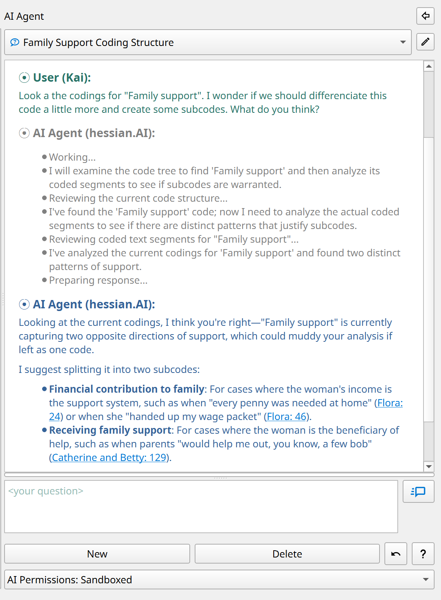
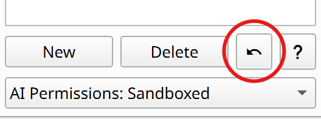
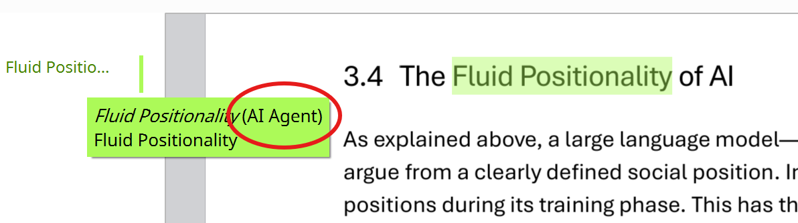
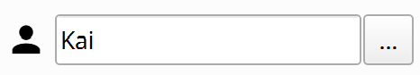
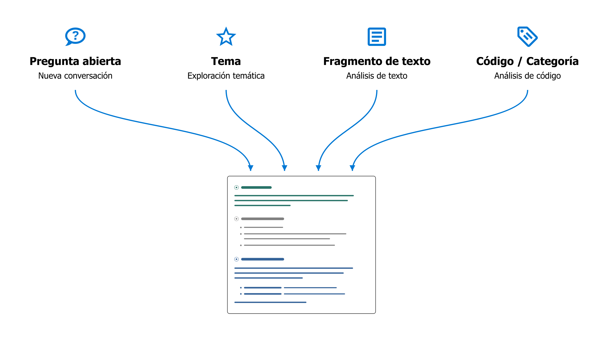
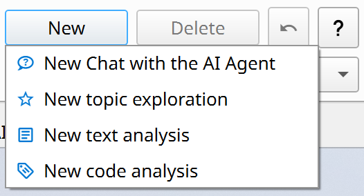

# Analizar datos con el agente de IA

## Principios fundamentales de la integración de IA {#core-principles-of-ai-integration}

**1) Diversidad de modelos de IA**

El agente de IA de QualCoder no está vinculado a un modelo concreto. Usted decide qué modelo de lenguaje utilizar: uno de los grandes modelos comerciales, un modelo de tamaño medio en una plataforma científica de IA o un modelo local en su propio ordenador. Encontrará más información en [Configuración de IA](./2.3.-AI-Setup.md).

**2) Diversidad metodológica**

El agente de IA de QualCoder no define un método propio, sino que ofrece una plataforma de experimentación flexible desde el punto de vista metodológico. Su pregunta de investigación, los conocimientos que busca obtener y su enfoque metodológico marcan la dirección. Cuando un procedimiento ha demostrado su utilidad, puede guardarlo y reutilizarlo más adelante (véase la [Biblioteca de prompts de IA](./6.2.-AI-Prompt-Library.md)).

**3) Transparencia**

Los prompts que guían el trabajo del agente de IA se pueden consultar y, en principio, adaptar. Durante su trabajo, el agente también informa continuamente sobre sus pasos y proporciona referencias detalladas a las fuentes. Así puede comprobar en qué datos se basa y examinar los pasajes en su contexto original.

**4) Colaboración en lugar de automatización**

El enfoque se centra en el diálogo con la IA: desarrollar perspectivas adicionales, cuestionar las propias interpretaciones y comprender mejor el material. Si se lo solicita, el agente también puede realizar tareas más largas de forma semiautónoma. Sin embargo, la automatización a gran escala nunca ha sido el objetivo principal.

## Trabajar con el agente de IA {#working-with-the-ai-agent}

- El agente de IA tiene su **propia pestaña** en QualCoder. También puede desplazarlo a una **barra lateral** (véase más abajo), junto a los datos, haciendo clic en el pequeño botón con una flecha.
{ width="118" }
- En la ventana de chat, describa con sus propias palabras qué desea investigar o trabajar.

{ width="600" }

!!! note
    La IA debe estar **completamente cargada** y lista para nuevas consultas antes de poder iniciar un chat (barra de estado: «IA: lista»).

### ¿Para qué sirve el agente de IA? {#what-is-the-ai-agent-for}

- El agente de IA le ayuda a **explorar su material empírico,** desarrollar interpretaciones y análisis, codificar datos y redactar memos.
- Puede conversar con la IA sobre pasajes concretos o buscar temas y casos contrastantes en todo el corpus del proyecto.
- Puede desarrollar su sistema de códigos, generar ideas y estrategias de análisis y contrastarlas directamente con el material empírico.
- A diferencia de los chatbots genéricos, el agente de IA de QualCoder **retoma el trabajo exactamente donde se ha quedado su análisis:** examina el sistema de códigos actual, puede leer memos y pasajes codificados, incorporar los casos y sus características (atributos) al análisis, etc. Así obtiene comentarios adaptados al estado actual de su investigación.

### ¿Qué puede hacer el agente de IA? {#what-can-the-ai-agent-do}

- Incluso con un simple **acceso de lectura** al proyecto, el agente de IA es una herramienta potente para generar ideas.
- Si se lo solicita, además de responder preguntas, puede **hacer avanzar activamente el análisis.** Con los permisos adecuados (véase más abajo), puede crear nuevos códigos o reorganizar los existentes, buscar y codificar nuevos pasajes, revisar memos o crear nuevos atributos de casos.
- Durante la conversación con el agente, puede revisar sus propuestas, hacer preguntas de seguimiento y decidir cómo continuar.

### ¿Cuáles son sus limitaciones? {#what-are-its-limitations}

- Actualmente, el agente de IA solo puede trabajar con **datos textuales**, no con imágenes, audio ni vídeo. Los diarios también quedan excluidos.
- Puede elegir entre tres niveles de permisos:

|Nivel de permisos|Descripción|
|---|---|
|**Solo lectura**|El agente de IA solo tiene acceso de lectura a los códigos, los memos y los datos empíricos.|
|**Entorno aislado** (por defecto)|Acceso de escritura limitado: el agente puede crear sus propios códigos y codificaciones, pero no modificar los existentes.|
|**Acceso completo**|El agente puede hacer casi todo lo que puede hacer una persona que utilice el programa, incluidos cambios en el sistema de códigos, los casos, los memos y los atributos.|

- Siempre se aplica un **límite estricto:** los propios datos empíricos constituyen la «verdad de referencia» de todo el análisis. La IA no puede modificarlos bajo ninguna circunstancia.
- Además, el agente de IA **no tiene acceso a información externa,** por ejemplo, de Internet. Por tanto, solo puede trabajar con los datos que usted haya incorporado deliberadamente al proyecto.

### ¿Cómo puedo ver qué cambios realiza la IA? {#how-can-i-see-which-changes-the-ai-makes}

- El agente **documenta sus pasos en el chat,** cita sus fuentes y pide autorización antes de realizar cambios importantes.
- Puede **deshacer** fácilmente los últimos cambios del agente de IA mediante el botón correspondiente en la ventana de chat:

    { width="250" }

- Todos los nuevos elementos que crea el agente (códigos, codificaciones, etc.) se identifican con el **nombre de codificador especial «AI Agent».**

    { width="600" }

- Para **mostrar u ocultar** los códigos generados por la IA, haga clic en los tres puntos («...») de la esquina superior izquierda del diálogo de codificación, junto al nombre del codificador actual, y ajuste la visibilidad de «AI Agent».

    { width="250" }

### ¿Cómo debo preparar mi proyecto? {#how-should-i-prepare-my-project}

- Es importante disponer de un **memo de proyecto** informativo (menú «Proyecto > Memo de proyecto»). Incluya lo siguiente:

    - La pregunta de investigación y los objetivos del proyecto
    - El tipo de material empírico (por ejemplo, entrevistas narrativas) y el enfoque de muestreo
    - El enfoque metodológico del análisis
    - Cualquier otra particularidad que el agente de IA deba tener en cuenta.

    El memo de proyecto se proporciona al agente como información de contexto en cada conversación.

- Los **nombres de los documentos** deben ser comprensibles (por ejemplo, «Entrevista Alice»).
- En las **transcripciones de entrevistas**, deben identificarse claramente las personas que entrevistan y las entrevistadas, de modo que sus roles sean reconocibles incluso en extractos breves.
- Unos buenos **memos de códigos** también ayudan a la IA a comprender lo que usted quiere decir.

!!! note
    **Comprobar si la estructura del proyecto es adecuada para la IA:** Con este comando del menú «IA», el agente analiza automáticamente el proyecto y propone mejoras para facilitar su lectura.

!!! note
    **Notas personales en los memos:** Si también desea utilizar los memos para notas personales, escríbalas después del separador `#####`. Todo lo que aparezca después es inaccesible para la IA.

### ¿Cómo funciona el agente de IA? {#how-does-the-ai-agent-work}

- El agente de IA solo actúa cuando usted le asigna una **tarea**, no por iniciativa propia.
- El agente procesa una tarea mediante un **bucle ReAct** (Reflect + Act, [Shunyu et al. 2022](https://arxiv.org/abs/2210.03629)):

    1. Elabora un plan para realizar la tarea.
    2. Ejecuta las acciones previstas (por ejemplo, buscar datos o leer códigos).
    3. Analiza los resultados y decide si son necesarias más acciones (por ejemplo, leer más datos). Si es así, vuelve al paso 2.

    Según la complejidad de la tarea, este bucle puede repetirse muchas veces. Los pasos individuales se muestran en gris en la ventana de chat.
    Cuando el resultado es satisfactorio (por ejemplo, cuando se han encontrado suficientes datos), el agente formula una respuesta final y espera nuevas instrucciones.

- El agente dispone de **herramientas potentes:** por ejemplo, puede realizar búsquedas por similitud semántica en todo el corpus, buscar mediante expresiones regulares o en un índice de palabras clave BM25 y utilizar herramientas para crear o modificar códigos si tiene permisos de escritura.

### ¿Qué ocurre con mis datos? {#what-happens-to-my-data}

- Todos los datos permanecen **almacenados localmente en su ordenador**, en el proyecto QualCoder actual. Las operaciones de búsqueda mencionadas también se ejecutan localmente.
- El **modelo de IA solo ve la parte de los datos** (por ejemplo, resultados de búsqueda o pasajes concretos) necesaria para el análisis en curso. Estos fragmentos de datos se envían al modelo de IA junto con la tarea correspondiente.
- En sus respuestas, el agente de IA documenta detalladamente los datos en los que basa sus análisis. QualCoder convierte estas referencias en **enlaces a las fuentes con números de línea.** Al hacer clic en una referencia, se abre el pasaje en su contexto original.

## Cuatro formas de iniciar una conversación con el agente {#four-ways-to-start-a-conversation-with-the-agent}

En la esquina inferior izquierda de la ventana del agente de IA, puede iniciar un nuevo análisis de una de estas cuatro formas:

{ width="250" }

Estas opciones simplemente ofrecen **distintos puntos de partida** para el análisis. Después puede orientar la conversación en cualquier dirección que desee.

### 1) Nuevo chat abierto {#1-new-open-chat}

Esta es la forma más flexible de iniciar un nuevo análisis con el agente. Comience con una idea o una pregunta abierta, o indique los códigos o pasajes que desea investigar.

**Ejemplo: buscar casos comparables**

> *«A partir de la línea 127, Sarah cuenta cómo fue su infancia en Inglaterra y que allí era principalmente su padre quien cuidaba de ella. ¿Hay casos similares en el material donde los hombres desempeñen un papel tan central en el trabajo de cuidados?»*

**Ejemplo: consolidar códigos**

> *«Tengo la impresión de que los códigos “Responsabilidad individual” y “Autonomía” se solapan a menudo. Examina los memos y los pasajes codificados. ¿Cómo podríamos distinguir mejor los códigos? ¿O sería preferible fusionarlos?»*
>
> Después: *«Bien, fusiona ambos códigos bajo el nuevo nombre “Responsabilidad sobre uno mismo” y adapta también el memo del código.»*

**Ejemplo: extraer información**

> *Examina todas las entrevistas para identificar la postura de cada persona entrevistada sobre las restricciones al uso de redes sociales por parte de niños y/o adolescentes. Asigna a cada persona entrevistada exactamente una categoría:  
> **pro** = explícitamente a favor de una restricción;  
> **contra** = explícitamente en contra de una restricción;  
> **undecided** = declaraciones pertinentes, pero ambivalentes, contradictorias o que no permiten una asignación clara;  
> **unknown** = ninguna declaración suficientemente pertinente.  
> Ten en cuenta solo las posturas que puedan atribuirse claramente a la persona entrevistada y comprueba el contexto de los pasajes encontrados. Primero, muéstrame para cada persona la categoría propuesta, una breve justificación y los pasajes determinantes con referencias a las fuentes. Señala explícitamente las contradicciones y las asignaciones inciertas.  
> Solo después de mi confirmación, crea el atributo «social_media_restriction» para las transcripciones de entrevistas, con los valores permitidos «pro», «contra», «undecided» y «unknown», y guarda las asignaciones.*

Para incorporar **prompts predefinidos o sus propios prompts** de la [Biblioteca de prompts de IA](./6.2.-AI-Prompt-Library.md) a la conversación, utilice la notación con barra: por ejemplo, «/in-vivo-coding» insertaría en la conversación actual el prompt correspondiente que haya guardado previamente en la biblioteca.

### 2) Exploración temática {#2-topic-exploration}

Este análisis resulta especialmente útil para obtener una **primera visión de conjunto** de cómo se aborda un tema concreto en el material empírico. Para preguntas sencillas con temas bien delimitados, esta función también permite elaborar análisis de síntesis que pueden utilizarse directamente como base para un informe.

- Esta opción abre un **diálogo** en el que puede definir y describir el tema y seleccionar los datos que se incluirán en el análisis.
- También puede elegir entre distintos **prompts analíticos**, como un resumen sencillo (topic-summary) o un análisis comparativo de casos (analyze-differences). Puede crear plantillas para sus propios análisis con instrucciones detalladas en la [Biblioteca de prompts de IA](./6.2.-AI-Prompt-Library.md) y utilizarlas aquí.
- La exploración temática comienza con una búsqueda en varios pasos en el material y después presenta un primer informe.

**Ejemplo: comparación exploratoria de casos**

> **Tema:** «Criar hijos en tiempos de guerra»  
> **Descripción:** «¿Cómo influye la guerra en la decisión de tener hijos? ¿Cómo cambia el trabajo de cuidados en tiempos de guerra? ¿Cómo intentan los padres y las madres hacer posible una infancia en condiciones de guerra?»  
> **Prompt analítico:** «analyze-differences»  
> **Filtro:** Solo se han seleccionado los casos «Ethel» y «Flora».
>
> **Resultado:** Un análisis comparativo de Ethel y Flora sobre el tema «Criar hijos en tiempos de guerra», estructurado en torno a las tres subpreguntas.

### 3) Análisis de texto {#3-text-analysis}

- Permite un **análisis detallado de un pasaje seleccionado, centrado en el texto,** con el agente de IA.
- Desarrolle conjuntamente nuevas lecturas y propuestas de códigos, o discuta ambivalencias, incertidumbres y cuestiones de interpretación pendientes.

Este análisis cambia primero al **espacio de trabajo de codificación de texto**.
Abra allí un documento, seleccione el pasaje que desea analizar y elija «Análisis de texto con IA» en el menú contextual que aparece al hacer clic derecho. Se abrirá un **submenú** en el que puede elegir entre distintos tipos de análisis de texto:

{ width="600" }

Mantenga brevemente el puntero sobre una opción para ver una descripción con más información.
También puede guardar sus propias instrucciones para el análisis de texto en la [Biblioteca de prompts de IA](./6.2.-AI-Prompt-Library.md). Aparecerán entonces entre las opciones de este submenú.

**Ejemplo: lluvia de ideas en las primeras fases de una lectura detallada**

> a) **Seleccione** un pasaje de entrevista especialmente rico en la pestaña «Codificar texto».  
> b) Haga clic derecho y elija «Análisis de texto con IA» > **«interactive-brainstorming-with-ai»**.  
> c) El espacio de trabajo cambia a la pestaña «Agente de IA». Allí, el agente pregunta primero por la **perspectiva de análisis** o el tema en el que desea profundizar.  
> d) A continuación comienza una **conversación sobre el material**, en la que exploran y discuten conjuntamente distintas interpretaciones posibles.  
> e) **Guarde los resultados:** Cuando termine, indique al agente de IA que guarde un resumen de los resultados como anotación de texto.

### 4) Análisis de códigos {#4-code-analysis}

- Analiza todos los **datos reunidos bajo un código o una categoría concretos,** incluidos los subcódigos.
- Discuta sus codificaciones con el agente de IA, compare distintos códigos, cree subcódigos o elabore informes.
- También puede seleccionar **varios códigos y/o categorías** para un análisis comparativo o de síntesis.

Un nuevo análisis de códigos también comienza abriendo un **diálogo** en el que puede seleccionar los códigos o las categorías que desea analizar, filtrar los datos que se incluirán y elegir un prompt analítico.
También puede crear sus propios prompts para esta función en la [Biblioteca de prompts de IA](./6.2.-AI-Prompt-Library.md).

**Ejemplo:**

> **Código:** «Solidaridad vecinal»  
> **Prompt analítico:** «theoretical-saturation-check»  
> **Filtro:** Sin filtro (= se incluyen todos los datos).
>
> **Resultado:** Un informe detallado sobre la «saturación teórica» del código actual o de la categoría seleccionada en el sentido de la teoría fundamentada. El agente de IA busca activamente en el material variantes aún no codificadas del fenómeno recogido por el código, casos límite y contraejemplos, para evaluar la saturación empírica y conceptual/teórica del código y detectar lagunas. También se tiene en cuenta el memo del código.

## Reflexión final: la cuestión de la antropomorfización {#a-final-reflection-on-anthropomorphism}

Decidimos deliberadamente no dar un nombre al agente de IA de QualCoder, como «Claude» de Anthropic. Sin embargo, el enfoque de integración de IA mediante el diálogo en QualCoder escenifica una especie de pseudointeracción que, en muchos aspectos, sigue patrones de interacción humana, por ejemplo, dentro de un equipo de investigación. En su [prompt de sistema fundamental](https://github.com/ccbogel/QualCoder/blob/master/src/qualcoder/ai_prompts/_agent.md), al agente de IA de QualCoder se le asigna precisamente ese papel de una especie de miembro del equipo. ¿Estamos, por tanto, antropomorfizando una máquina al interactuar con ella como si fuera una persona que investiga?

En cierta medida, sí. Pero me parece más útil considerar estas interacciones como una especie de «juego de rol», tal como propusieron [Shanahan, McDonell & Reynolds 2023](https://www.nature.com/articles/s41586-023-06647-8). Los modelos de lenguaje actuales se entrenan con interacciones lingüísticas humanas. Por eso funcionan mejor cuando se integran en ese tipo de situaciones de interacción. No obstante, un uso de la IA basado en la reflexión metodológica dentro de la investigación social cualitativa exige recordar que estamos participando en un juego de rol inducido por la tecnología, no interactuando con un interlocutor humano.

## Otras funciones {#further-functions}

- En la **[Biblioteca de prompts de IA](./6.2.-AI-Prompt-Library.md)**, puede guardar estrategias de análisis y enfoques metodológicos que hayan demostrado su utilidad como instrucciones reutilizables.
- La **[Codificación asistida por IA](./4.2.-AI-Assisted-Coding.md)**, en el espacio «Codificar texto», utiliza una búsqueda basada en IA para ayudarle a encontrar pasajes relevantes para un código concreto en todo el corpus.
- Si tiene **preguntas sobre el uso de QualCoder**, el agente de IA también puede ayudarle, ofreciendo respuestas basadas en la documentación de QualCoder. Seleccione *Ayuda > Preguntar al agente de IA* en el menú principal.