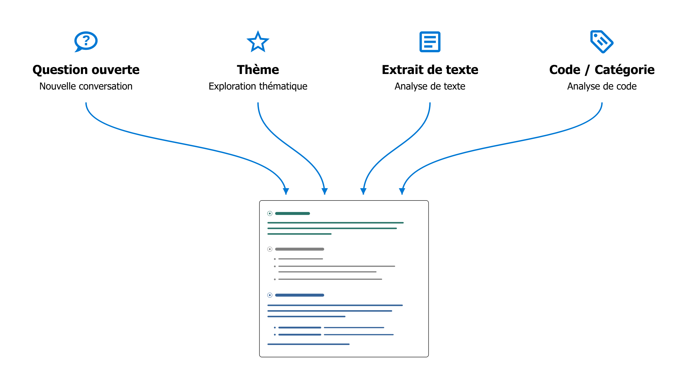

# Analyser les données avec l’agent IA

## Principes fondamentaux de l’intégration de l’IA

**1) Choix des modèles d’IA**

L’agent IA de QualCoder n’est pas lié à un modèle particulier. Vous choisissez le modèle de langage que vous souhaitez utiliser : l’un des grands modèles commerciaux, un modèle de taille moyenne sur une plateforme d’IA scientifique ou un modèle local sur votre propre ordinateur. Pour en savoir plus, consultez la page [Configuration de l’IA](./2.3.-AI-Setup.md).

**2) Diversité des méthodes**

L’agent IA de QualCoder ne définit pas sa propre méthode, mais offre une plateforme d’expérimentation souple sur le plan méthodologique. Votre question de recherche, les connaissances que vous cherchez à produire et votre démarche méthodologique orientent le travail. Lorsqu’une démarche a fait ses preuves, vous pouvez l’enregistrer et la réutiliser ultérieurement (voir la [Bibliothèque d’instructions IA](./6.3.-AI-Prompt-Library.md)).

**3) Transparence**

Les instructions qui guident le travail de l’agent IA sont consultables et peuvent, en principe, être adaptées. Pendant son travail, l’agent vous informe également de ses étapes et fournit des références détaillées aux sources. Vous pouvez ainsi comprendre sur quelles données il s’appuie et examiner les passages dans leur contexte d’origine.

**4) Collaboration plutôt qu’automatisation**

L’accent est mis sur le dialogue avec l’IA : développer de nouvelles perspectives, interroger ses propres interprétations et mieux comprendre le matériau. Sur demande, l’agent peut aussi exécuter des tâches plus longues de manière semi-autonome. L’automatisation à grande échelle n’a toutefois jamais été l’objectif principal.

## Travailler avec l’agent IA

- L’agent IA dispose de son **propre onglet** dans QualCoder. Vous pouvez aussi le déplacer dans une **barre latérale** (voir ci-dessous), à côté de vos données, en cliquant sur le petit bouton en forme de flèche.
{ width="118" }
- Dans la fenêtre de discussion, décrivez avec vos propres mots ce que vous souhaitez étudier ou traiter.

{ width="600" }

!!! note
    L’IA doit être **entièrement chargée** et prête à recevoir de nouvelles requêtes avant de pouvoir commencer une discussion (barre d’état : « IA : prête »).

### À quoi sert l’agent IA ?

- L’agent IA vous aide à **explorer votre matériau empirique**, à développer des interprétations et des analyses, à coder les données et à rédiger des mémos.
- Vous pouvez discuter de passages particuliers avec l’IA ou rechercher des thèmes et des cas contrastés dans l’ensemble du corpus du projet.
- Vous pouvez faire évoluer votre système de codes, réfléchir à des idées et à des stratégies d’analyse, puis les confronter directement au matériau empirique.
- Contrairement aux chatbots génériques, l’agent IA de QualCoder **reprend exactement là où votre analyse en est :** il examine le système de codes actuel, peut lire les mémos et les passages codés, intégrer les cas et leurs caractéristiques (attributs) à l’analyse, etc. Vous obtenez ainsi des retours adaptés à l’état actuel de votre recherche.

### Que peut faire l’agent IA ?

- Même avec un simple **accès en lecture** au projet, l’agent IA est un outil puissant pour explorer des idées.
- Sur demande, il peut aussi **faire avancer activement l’analyse**, au-delà des réponses à vos questions. Avec les autorisations appropriées (voir ci-dessous), il peut créer de nouveaux codes ou réorganiser les codes existants, rechercher et coder de nouveaux passages, réviser des mémos ou créer de nouveaux attributs de cas.
- Dans le dialogue avec l’agent, vous pouvez examiner ses propositions, poser des questions complémentaires et décider de la suite du travail.

### Quelles sont ses limites ?

- Actuellement, l’agent IA ne peut travailler qu’avec des **données textuelles**, pas avec des images, des fichiers audios ou des vidéos. Les journaux sont également exclus.
- Vous pouvez choisir entre trois niveaux d’autorisation :

|Niveau d’autorisation|Description|
|---|---|
|**Lecture seule**|L’agent IA dispose uniquement d’un accès en lecture aux codes, aux mémos et aux données empiriques.|
|**Bac à sable** (par défaut)|Accès limité en écriture : l’agent peut créer ses propres codes et codages, mais ne peut pas modifier ceux qui existent déjà.|
|**Accès complet**|L’agent peut faire presque tout ce qu’une personne utilisant le logiciel peut faire, notamment modifier le système de codes, les cas, les mémos et les attributs.|

- Une **limite stricte** s’applique toujours : les données empiriques elles-mêmes constituent la « vérité de terrain » de toute l’analyse. L’IA ne peut les modifier en aucun cas.
- L’agent IA n’a par ailleurs **aucun accès à des informations externes**, par exemple sur Internet. Il ne peut donc travailler qu’avec les données que vous avez délibérément intégrées au projet.

### Comment voir les modifications effectuées par l’IA ?

- L’agent **documente ses étapes dans la discussion**, cite ses sources et demande votre accord avant d’effectuer des modifications importantes.
- Vous pouvez facilement **annuler** les dernières modifications de l’agent IA à l’aide du bouton correspondant dans la fenêtre de discussion :

    { width="250" }

- Tous les nouveaux éléments créés par l’agent (codes, codages, etc.) portent le **nom de codeur spécifique « AI Agent ».**

    { width="600" }

- Pour **afficher ou masquer** les codes générés par l’IA, cliquez sur les trois points (« ... ») en haut à gauche de la fenêtre de codage, à côté du nom du codeur actuel, et réglez la visibilité pour « AI Agent ».

    { width="250" }

### Comment préparer mon projet ?

- Un **mémo de projet** informatif est important (menu « Projet > Mémo de projet »). Consignez-y les éléments suivants :

    - La question de recherche et les objectifs du projet
    - Le type de matériau empirique (par exemple, des entretiens narratifs) et la démarche d’échantillonnage
    - L’approche méthodologique de l’analyse
    - Toute autre particularité que l’agent IA doit prendre en compte.

    Le mémo de projet est transmis à l’agent comme information de contexte pour chaque conversation.

- Les **noms des documents** doivent être explicites (par exemple, « Entretien Alice »).
- Dans les **retranscriptions d’entretiens**, les personnes qui mènent l’entretien et celles qui y répondent doivent être clairement identifiées, afin que leurs rôles soient reconnaissables même dans de courts extraits.
- De bons **mémos de codes** aident également l’IA à comprendre ce que vous voulez dire.

!!! note
    **Vérifier si la structure du projet est adaptée à l’IA** : Cette commande du menu « IA » permet à l’agent d’analyser automatiquement le projet et de proposer des améliorations de sa lisibilité.

!!! note
    **Notes personnelles dans les mémos** : Si vous souhaitez aussi utiliser les mémos pour des notes personnelles, placez celles-ci après le séparateur `#####`. Tout ce qui suit est inaccessible à l’IA.

### Comment fonctionne l’agent IA ?

- L’agent IA n’agit que lorsque vous lui confiez une **tâche**, jamais de sa propre initiative.
- L’agent traite une tâche dans une **boucle ReAct** (Reflect + Act, [Shunyu et al. 2022](https://arxiv.org/abs/2210.03629)) :

    1. Il établit un plan pour réaliser la tâche.
    2. Il exécute les actions prévues (par exemple, rechercher des données ou lire des codes).
    3. Il analyse les résultats et décide si d’autres actions sont nécessaires (par exemple, lire davantage de données). Si c’est le cas, il revient à l’étape 2.

    Selon la complexité de la tâche, cette boucle peut se répéter de nombreuses fois. Les différentes étapes sont affichées en gris dans la fenêtre de discussion.
    Lorsque le résultat est satisfaisant (par exemple, lorsque suffisamment de données ont été trouvées), l’agent formule une réponse finale et attend de nouvelles instructions.

- L’agent dispose d’**outils puissants** : il peut, par exemple, effectuer une recherche par similarité sémantique dans l’ensemble du corpus, rechercher à l’aide d’expressions régulières ou dans un index de mots-clés BM25, et utiliser des outils pour créer ou modifier des codes s’il dispose des droits d’écriture.

### Que deviennent mes données ?

- Toutes les données restent **stockées localement sur votre ordinateur**, dans le projet QualCoder en cours. Les opérations de recherche mentionnées ci-dessus sont également exécutées localement.
- Le **modèle d’IA ne voit que les données** (par exemple, des résultats de recherche ou des passages particuliers) nécessaires à l’analyse en cours. Ces fragments de données sont envoyés au modèle d’IA avec la tâche correspondante.
- Dans ses réponses, l’agent IA documente en détail les données sur lesquelles reposent ses analyses. QualCoder transforme ces références en **liens vers les sources avec des numéros de ligne**. Un clic sur une référence ouvre le passage dans son contexte d’origine.

## Quatre façons d’engager la conversation avec l’agent

En bas à gauche de la fenêtre de l’agent IA, vous pouvez démarrer une nouvelle analyse de l’une des quatre façons suivantes :

{ width="250" }

Ces options constituent simplement **différents points de départ** pour l’analyse. Vous pouvez ensuite orienter la conversation dans la direction de votre choix.

### 1) Nouvelle discussion ouverte

C’est la façon la plus souple de démarrer une nouvelle analyse avec l’agent. Commencez par une idée ou une question ouverte, ou indiquez les codes ou les passages que vous souhaitez étudier.

**Exemple : rechercher des cas comparables**

> *« À partir de la ligne 127, Sarah raconte son enfance en Angleterre et explique que c’était surtout son père qui s’occupait d’elle. Y a-t-il des cas similaires dans le matériau où les hommes jouent un rôle aussi central dans le travail de soin ? »*

**Exemple : consolider des codes**

> *« J’ai l’impression que les codes “Responsabilité individuelle” et “Autonomie” se recoupent souvent. Examine les mémos et les passages codés. Comment pourrions-nous mieux distinguer ces codes ? Ou serait-il préférable de les fusionner ? »*
>
> Puis : *« Bien, fusionne les deux codes sous le nouveau nom “Prise de responsabilité pour soi” et adapte le mémo du code en conséquence. »*

**Exemple : extraire des informations**

> *Examine tous les entretiens pour identifier la position de chaque personne interrogée sur les restrictions de l’utilisation des réseaux sociaux par les enfants et/ou les adolescents. Attribue exactement une catégorie à chaque personne interrogée :  
> **pro** = explicitement favorable à une restriction ;  
> **contra** = explicitement opposée à une restriction ;  
> **undecided** = propos pertinents, mais ambivalents, contradictoires ou ne permettant pas une attribution claire ;  
> **unknown** = aucun propos suffisamment pertinent.  
> Ne prends en compte que les positions qui peuvent être clairement attribuées à la personne interrogée et vérifie le contexte des passages trouvés. Présente-moi d’abord, pour chaque personne, la catégorie proposée, une brève justification et les passages déterminants avec leurs références aux sources. Signale explicitement les contradictions et les attributions incertaines.  
> Seulement après ma confirmation, crée l’attribut « social_media_restriction » pour les transcriptions d’entretiens, avec les valeurs autorisées « pro », « contra », « undecided » et « unknown », et enregistre les attributions.*

Pour intégrer à la conversation des **instructions prédéfinies ou vos propres instructions** de la [Bibliothèque d’instructions IA](./6.3.-AI-Prompt-Library.md), utilisez la notation avec une barre oblique : par exemple, « /in-vivo-coding » insère dans la conversation en cours l’instruction correspondante que vous avez précédemment enregistrée dans la bibliothèque.

### 2) Exploration thématique

Cette analyse est particulièrement utile pour obtenir un **premier aperçu** de la manière dont un thème est abordé dans le matériau empirique. Pour des questions de recherche simples portant sur des thèmes bien délimités, cette fonction peut également produire des analyses de synthèse qui peuvent être directement retravaillées dans un rapport.

- Cette option ouvre une **boite de dialogue** dans laquelle vous pouvez définir et décrire le thème, puis sélectionner les données à inclure dans l’analyse.
- Vous pouvez également choisir entre différentes **instructions analytiques**, par exemple une simple synthèse (topic-summary) ou une analyse comparative de cas (analyze-differences). Vous pouvez créer des modèles pour vos propres analyses, accompagnés de consignes détaillées, dans la [Bibliothèque d’instructions IA](./6.3.-AI-Prompt-Library.md), puis les utiliser ici.
- L’exploration thématique commence par une recherche en plusieurs étapes dans le matériau, puis présente un premier rapport.

**Exemple : comparaison exploratoire de cas**

> **Thème**  :« Élever des enfants en temps de guerre »  
> **Description** : « Comment la guerre influence-t-elle la décision d’avoir des enfants ? Comment le travail de soin évolue-t-il en temps de guerre ? Comment les parents tentent-ils de préserver la possibilité d’une enfance dans des conditions de guerre ? »  
> **Instruction analytique** : « analyze-differences »  
> **Filtre** : seuls les cas « Ethel » et « Flora » sont retenus.
>
> **Résultat** : Une analyse comparative d’Ethel et de Flora sur le thème « Élever des enfants en temps de guerre », structurée autour des trois sous-questions.

### 3) Analyse de texte

- Permet une **analyse au plus près du texte d’un passage sélectionné** avec l’agent IA.
- Développez ensemble de nouvelles lectures et des propositions de codes, ou discutez des ambivalences, des incertitudes et des questions d’interprétation encore ouvertes.

Cette analyse bascule d’abord vers **l’espace de codage de texte**.
Ouvrez-y un document, sélectionnez le passage à analyser et choisissez « Analyse de texte par IA » dans le menu contextuel accessible par clic droit. Un **sous-menu** s’ouvre, dans lequel vous pouvez choisir entre différents types d’analyse de texte :

{ width="600" }

Laissez brièvement le pointeur sur une entrée pour afficher une infobulle contenant davantage d’informations.
Vous pouvez également enregistrer vos propres instructions d’analyse de texte dans la [Bibliothèque d’instructions IA](./6.3.-AI-Prompt-Library.md). Elles apparaîtront alors parmi les options de ce sous-menu.

**Exemple : échange d’idées au début d’une lecture approfondie**

> a) **Sélectionnez** un passage d’entretien particulièrement riche dans l’onglet « Coder le texte ».  
> b) Faites un clic droit, puis choisissez « Analyse de texte par IA » > **« interactive-brainstorming-with-ai »**.  
> c) L’espace de travail bascule vers l’onglet « Agent IA ». L’agent vous demande d’abord quelle **perspective d’analyse** ou quel thème vous souhaitez approfondir.  
> d) Une **conversation sur le matériau** commence alors, au cours de laquelle vous explorez et discutez ensemble différentes interprétations possibles.  
> e) **Conservez les résultats** : Lorsque vous avez terminé, demandez à l’agent IA d’enregistrer une synthèse des résultats sous forme d’annotation de texte.

### 4) Analyse de codes

- Analyse toutes les **données regroupées sous un code ou une catégorie donnés**, y compris les sous-codes.
- Discutez de vos codages avec l’agent IA, comparez différents codes, créez des sous-codes ou produisez des rapports.
- Vous pouvez également sélectionner **plusieurs codes et/ou catégories** pour une analyse comparative ou une synthèse.

Une nouvelle analyse de codes commence également par l’ouverture d’une **boîte de dialogue**, dans laquelle vous pouvez sélectionner les codes ou les catégories à analyser, filtrer les données à inclure et choisir une instruction analytique.
Vous pouvez aussi créer vos propres instructions pour cette fonction dans la [Bibliothèque d’instructions IA](./6.3.-AI-Prompt-Library.md).

**Exemple** :

> **Code** : « Solidarité de voisinage »  
> **Instruction analytique** : « theoretical-saturation-check »  
> **Filtre** : aucun filtre (= toutes les données sont incluses).
>
> **Résultat** : un rapport détaillé sur la « saturation théorique » du code actuel ou de la catégorie sélectionnée au sens de la théorie ancrée. L’agent IA recherche activement dans le matériau des variantes encore non codées du phénomène saisi par le code, des cas limites et des contrexemples, afin d’évaluer la saturation empirique et conceptuelle/théorique du code et de repérer les lacunes. Le mémo du code est également pris en compte.

## Pour conclure : la question de l’anthropomorphisation

Nous avons délibérément choisi de ne pas donner de nom à l’agent IA de QualCoder, comme « Claude » chez Anthropic. Néanmoins, l’approche dialogique de l’intégration de l’IA dans QualCoder met en scène une forme de pseudo-interaction qui s’inspire, à bien des égards, des modes d’interaction humains, par exemple au sein d’une équipe de recherche. Dans son [instruction système fondamentale](https://github.com/ccbogel/QualCoder/blob/master/src/qualcoder/ai_prompts/_agent.md), l’agent IA de QualCoder se voit précisément attribuer ce rôle de quasi-membre de l’équipe. Anthropomorphisons-nous donc une machine en interagissant avec elle comme s’il s’agissait d’une personne menant une recherche ?

Dans une certaine mesure, c’est effectivement le cas. Mais il me semble plus pertinent de considérer ces interactions comme une forme de « jeu de rôle », comme l’ont proposé [Shanahan, McDonell & Reynolds 2023](https://www.nature.com/articles/s41586-023-06647-8). Les modèles de langage actuels sont entrainés sur des interactions langagières humaines. Ils fonctionnent donc au mieux lorsqu’ils sont intégrés à ce type de situation d’interaction. Néanmoins, une utilisation de l’IA qui s’appuie sur une réflexion méthodologique en recherche qualitative en sciences sociales exige de garder à l’esprit qu’il s’agit d’un jeu de rôle induit par la technologie, et non d’une interaction avec un interlocuteur humain.

## Autres fonctions

- Dans la **[Bibliothèque d’instructions IA](./6.3.-AI-Prompt-Library.md)**, vous pouvez enregistrer des stratégies d’analyse et des démarches méthodologiques qui ont fait leurs preuves sous forme d’instructions réutilisables.
- Le **[Codage assisté par IA](./4.2.-AI-Assisted-Coding.md)**, dans l’espace « Coder le texte », utilise une recherche fondée sur l’IA pour vous aider à trouver, dans l’ensemble du corpus, des passages correspondant à un code donné.
- Si vous avez des **questions sur l’utilisation de QualCoder**, l’agent IA peut aussi vous aider en produisant des réponses fondées sur la documentation de QualCoder. Dans le menu principal, choisissez *Aide > Demander à l’agent IA*.
